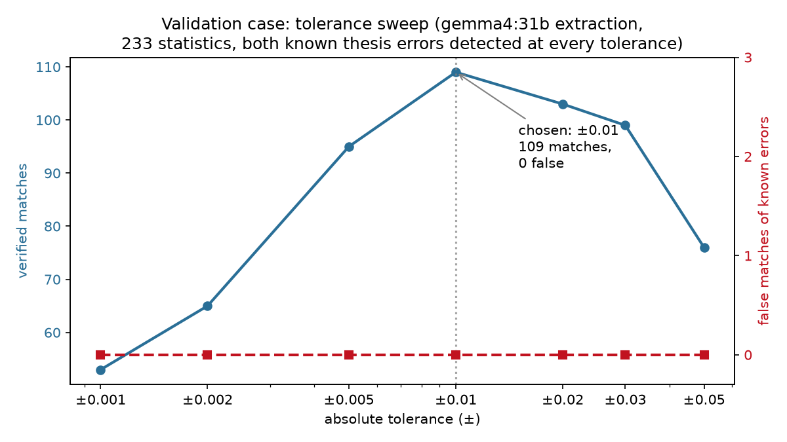

# project-veritas

A statistics auditor for published research papers. Give it a paper and the raw
data behind it: it extracts every published statistic, recomputes each one from
the data, and shows the exact calculation behind every match or mismatch.

Built and validated on a real case: it audited my MD thesis on REM vs. NREM sleep
apnea and flagged both known value errors in it (errors independently confirmed by
a separate hand analysis of the raw data).

**AI disclosure:** Built with AI assistance for code drafting. Every feature,
threshold, and test protocol was chosen by me, and the validation case (my own
thesis, with independently known errors) was my design. AI accelerated the work;
it did not make the scientific decisions.

## Why

Published statistics are rarely re-checked. A transposed digit, an SD copied into
the wrong cell, a mean that is not the mean of the cohort: errors like these
survive into the literature because verification is tedious. project-veritas makes
it mechanical. The auditor never takes the paper's word; it recomputes from raw
data and shows the exact expression that produced each verdict.

## How it works

```
paper (txt/docx) ──┐
                   ├──► extract (LLM) ──► verify (battery) ──► report
raw data (csv/xlsx)┘         │                   │
                  every statistic        each statistic recomputed
                  with its snippet,      from the data (pandas):
                  validated & deduped    verdict + provenance
```

1. **Extract.** An LLM (whatever your endpoint serves; configured in
   `config.yaml`) reads the paper in chunks and proposes every statistic: value,
   kind (mean/std/count/p/r/other), table, and the exact snippet containing it. A
   deterministic gauntlet then checks each proposal: the snippet must really occur
   in the paper, the digits must appear in that snippet, kinds must come from a
   fixed vocabulary, duplicates are dropped. The LLM proposes; it never verifies.
2. **Verify.** No LLM in this step. A battery recomputes what the data can
   produce: every mean, SD, min, max, median, and count, overall and per
   subgroup. Each published statistic is compared against the battery at a strict
   ±0.01 absolute tolerance (justified by a tolerance sweep, below), with
   semantic de-duplication so each match stays unique.
3. **Verdicts with provenance.** Every result carries the exact pandas expression
   that produced the number:

   > MATCH: Total Sleep Time (Male) = 362.04 →
   > `df.loc[df['sex']==1, 'tst_min'].mean()` = 362.0437

   A published value that ties between an overall statistic and one or more
   subgroup statistics resolves to the overall one and is labelled
   `MATCH (tie-break: overall)`, so the inference is visible in the report instead
   of folded into a plain MATCH. Remaining ties go to the user as a dropdown
   listing every candidate. Nothing is silently guessed.

## The validation case

I validated the tool against my own thesis, whose errors are independently known
from a prior hand analysis:

| Known error | Published | True value | Tool verdict |
|---|---|---|---|
| REM-AHI total mean | 59.92 | 54.92 | NO MATCH (all 3 occurrences) |
| REM-AHI female SD | 31.04 | 41.04 | NO MATCH |

2/2 known errors detected, zero false verifications, at every tolerance tested
(±0.001 to ±0.05). A third, test-selection error (a one-sample t-test presented
in a REM-vs-NREM context) is documented but out of scope: value verification
checks numbers, not test choices.

The tolerance was chosen empirically. A sweep from ±0.001 to ±0.05 shows matches
peaking at ±0.01, with zero false matches of the known errors at every tolerance.
Wider tolerances lose matches rather than gain them: more published values fall
inside the window, so more of them become ties and are withheld as collisions
instead of being credited.



**Run summary** on the committed extraction artifact (233 statistics from the
23k-character thesis):

| Verdict | n | Meaning |
|---|---|---|
| MATCH | 77 | Recomputed from data, expression shown |
| MATCH (tie-break: overall) | 7 | Tied with a subgroup coincidence; overall statistic won |
| MATCH (restatement) | 25 | The paper restates a verified number in prose |
| NO MATCH | 18 | No data-supported value (includes the 2 known errors) |
| COLLISION | 18 | Genuine ties, resolved by the user via dropdown |
| UNCHECKABLE | 88 | p-values, r coefficients, outside the battery's scope |

**Full-paper run** with `cx/gpt-6-luna` over all 36 chunks: 486 statistics
extracted, all 486 validated, no discarded proposals and no truncated chunks.
213 of them verified (124 MATCH, 78 restatement, 11 tie-break), 52 NO MATCH, 39
collisions, 182 uncheckable. Both known errors flagged.

Subgroup standard deviations are computed and matched. An earlier version never
built that part of the battery: a dead guard meant only subgroup *means* and
*counts* existed, so 43 standard deviations were reported as NO MATCH against
data that did contain them. Fixing it moved MATCH from 59 to 77 and NO MATCH from
56 to 18, and both known thesis errors stayed flagged. Recall recovered, nothing
was unmasked.

Full methodology and per-model results: [`docs/`](docs/).

## Model choice

Four extraction models were compared on an identical protocol
([10-chunk A/B](docs/model_ab_10chunk.md), then full-paper runs).

**10-chunk A/B** (chunks 0 to 9, identical pipeline and audit):

| Model | Time (s) | Stats | MATCH | NO MATCH | COLLISION | UNCHECKABLE |
|---|---|---|---|---|---|---|
| GLM-4.7-flash (reasoning) | 461 | 26 | 6 | 14 | 3 | 3 |
| nemotron-3-super | 177 | 25 | 4 | 10 | 0 | 11 |
| gemma4:31b | 23 | 23 | 6 | 10 | 3 | 4 |
| ling-3.0-flash | 63 | 31 | 6 | 14 | 3 | 8 |

gemma-4-31b was 20 times faster than GLM and 7.7 times faster than nemotron, and
all four put every proposed statistic through the validation gauntlet. The audit
even caught GLM emitting an age range ("20-65") as one malformed statistic, which
nemotron and gemma both split correctly.

**Full-paper runs** (all 36 chunks):

| Model | Full-paper extraction | Verified matches |
|---|---|---|
| ling-3.0-flash | 6.5 min, 234 stats | 70 |
| gemma-4-31b | 4.3 min, 233 stats, no gaps | 80 |
| cx/gpt-6-luna | 18 min, 486 stats, no gaps | 213 |

The gemma and ling runs predate the subgroup-SD fix, so their match counts come
from the old battery. Quote the Luna row or re-run them yourself. GLM stalled at
seven hours and nemotron never completed a full paper, so neither has a row here.

Nine statistics were found identically by all four of the models compared in the
A/B. The verdicts are model-independent: the verifier is deterministic, the
extractor only proposes.

## Features

Every published value the battery cannot assign to exactly one statistic becomes
a dropdown of the actual candidates, in the same interface that runs the audit.
Known-safe skips are operator decisions.

Extraction checkpoints per chunk. A manifest records completed chunks and their
entries, so an interrupted run resumes where it stopped rather than paying for
the whole paper again. Chunk keys include a hash of the chunk text, so editing
the paper invalidates stale progress instead of reusing it. Transient upstream
failures retry with backoff, and a genuine authentication error fails immediately
rather than burning a minute of retries.

A truncated chunk is flagged in the output as `extraction_incomplete`. Unparseable
model output is reported, never guessed. Any OpenAI-compatible provider works
(local LM Studio, Ollama, hosted routers); keys live in `~/.veritas/`, never in
the repo.

## Quick start

```bash
git clone https://github.com/Mahyarrk/project-veritas
cd project-veritas
uv sync
uv run streamlit run gui.py
```

Set the base URL, API key and model on the first screen. Then upload a paper and
its dataset and press Run.

The validation case needs the thesis dataset, which is not in the repo (see
limitation 5):

```bash
uv run validate_case.py           # audit the committed extraction artifact
uv run validate_case.py --fresh   # re-extract first (needs the endpoint + key)
```

Configure the extraction model and the audit tolerance in `config.yaml`. Supply
the key as `VERITAS_EXTRACT_KEY`; `VERITAS_EXTRACT_URL` and
`VERITAS_EXTRACT_MODEL` override the config block at run time.

## Limitations

1. **One validation case.** The tool was built and tuned on a single paper, my
   own thesis. It has not run blind on third-party papers yet; that is the next
   step.
2. **Value errors only.** The auditor checks whether published numbers match the
   data. It cannot detect wrong test choices, wrong denominators beyond the
   data's cohorts, or selective reporting.
3. **Recall is unmeasured.** Every MATCH shows the expression that produced it,
   but there is no gold-standard set of every statistic in the thesis, so how much
   of each paper actually gets checked is unknown. In the committed artifact, 88
   of 233 extracted values are uncheckable by construction. Coverage is a lower
   bound, not a measurement.
4. **The data must be the included cohort.** If the paper excluded participants,
   the file must contain only the included cases. Auditing unfiltered data
   produces false mismatches; I saw exactly that before fixing the input.
5. **The dataset is not published.** The thesis text is in the repo under CC BY
   4.0, but the patient-level CSV is not: 42 records, and age plus sex plus BMI
   uniquely identifies every one of them. A fresh clone can audit the committed
   extraction artifact, but `--fresh` needs data you supply.
6. **Statistical scope is bounded, and extraction is LLM-dependent.** p-values,
   correlation coefficients, and subset statistics beyond categorical splits (for
   example a BMI≥30 subgroup) are extracted but not yet recomputable; the battery
   covers means, SDs, min/max, medians and counts, overall and per categorical
   split. No extraction is exhaustive either. The gauntlet catches malformed
   proposals (one model emitted "20-65" as a single minimum; rejected) and a
   token-limited chunk is flagged rather than silently dropped, but a statistic
   the model never proposed is invisible to every later stage.
7. **Collisions still occur in constant columns.** Boolean-like clinical columns
   whose values never vary produce statistics that tie each other endlessly. They
   are excluded from the numeric battery, but they can still be assigned as
   prevalences and then tie. Expect a handful of uninformative collisions on any
   dataset with near-constant flags.

## Author

**Dr. Mahyar Mirzazadeh, MD** - [LinkedIn](https://www.linkedin.com/in/mahyar-mirzazadeh-550b3b166)

## Repository layout

```
core.py           config, endpoint client, paper + dataset loading (one each)
extract.py        LLM statistic extraction, validation gauntlet, resume
verify.py         the auditor: battery, matching, tie-break, verdicts
gui.py            Streamlit UI, the only interface
validate_case.py  validation against known thesis errors + tolerance sweep
config.yaml       model settings, tolerance, paths
docs/             model benchmarks, validation protocols, technical reports
runs/             committed run artifacts: extraction outputs, audit reports
scripts/          utility scripts (validation chart generator)
sources/          thesis text (CC BY 4.0); the dataset is not committed
```

`verify.py` contains no model calls. That is the design, not an accident: the
extractor proposes claims, the auditor recomputes them from raw data and shows
the expression behind every verdict.
